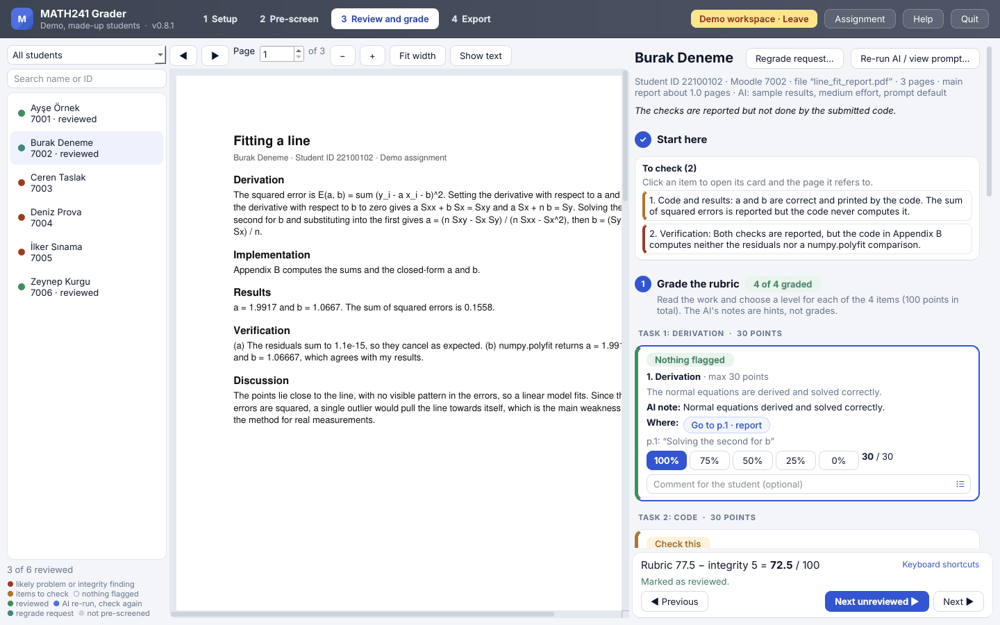
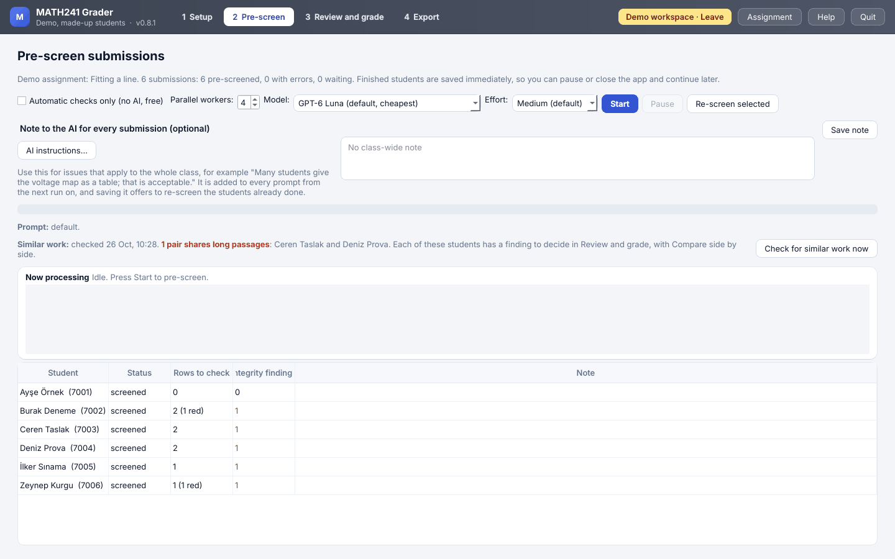
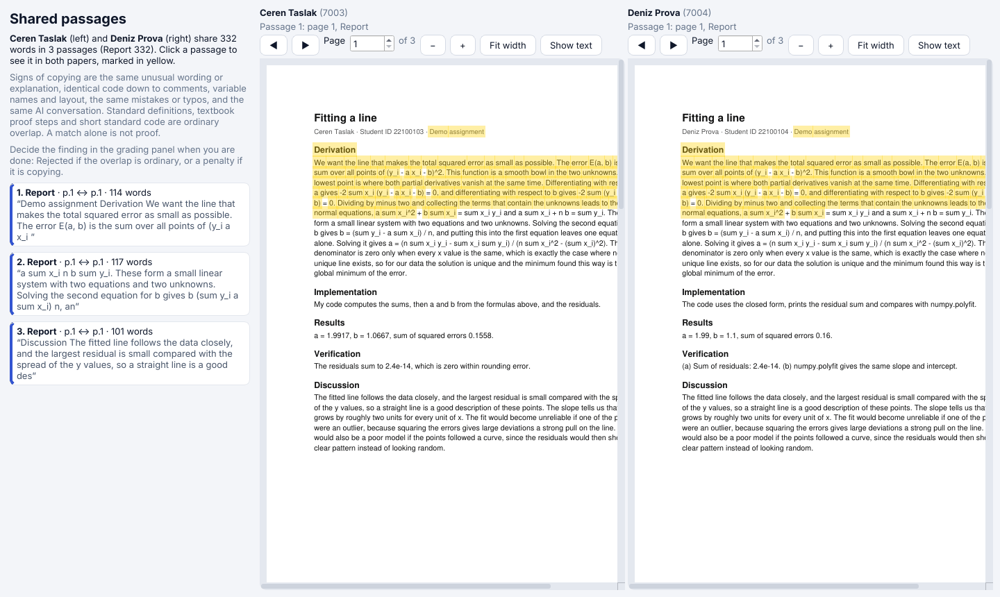
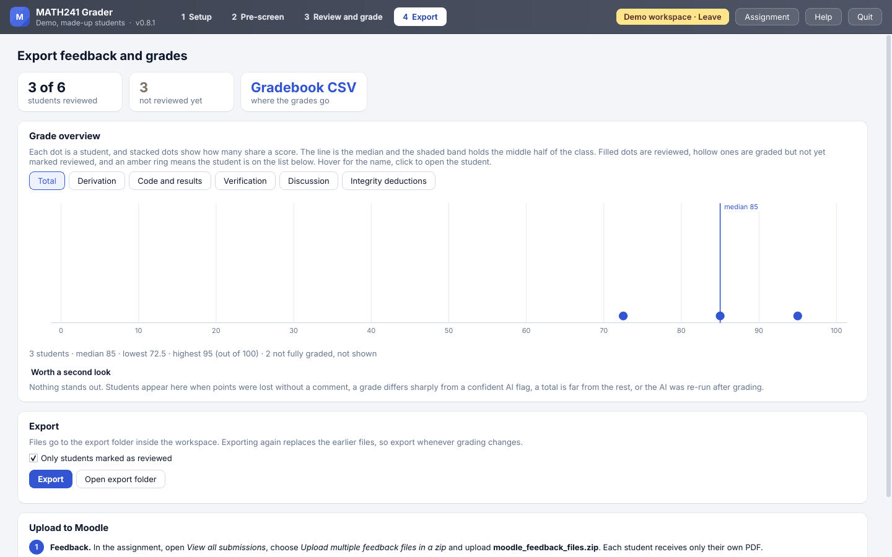
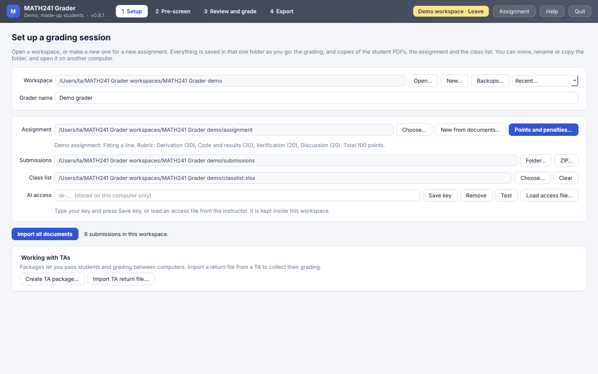
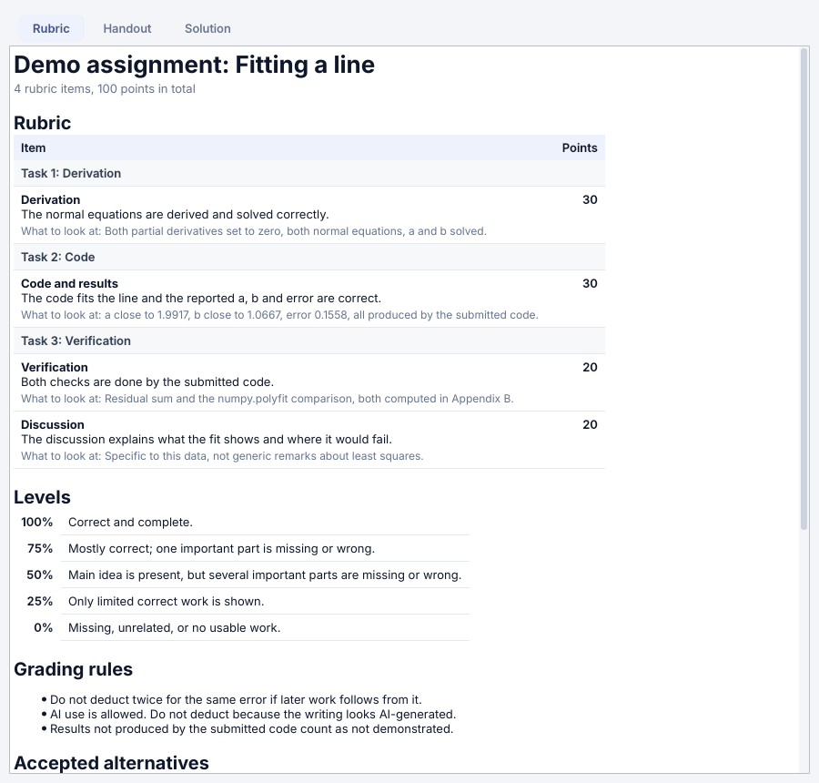
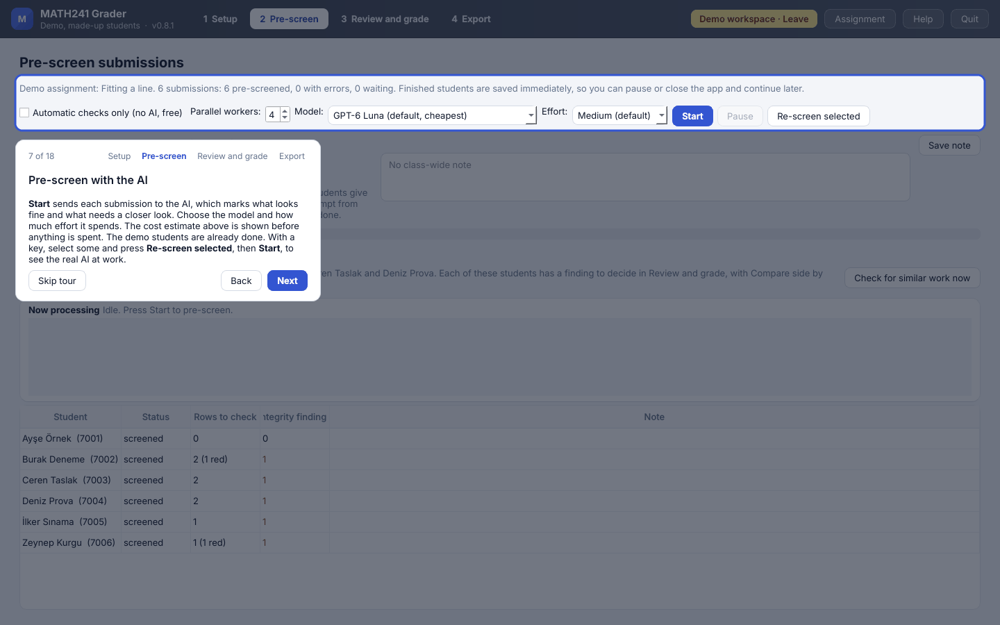

# MATH241 Grader

A desktop app for grading AI-assisted assignments in MATH 241 at Bilkent University. The AI pre-screens each student's PDF and points the grader to what needs a closer look. The grader decides every rubric level and every integrity finding. The app then writes one feedback PDF per student and the files for Moodle.

This repository holds the app only. Assignments (with their solutions) and workspaces (with student papers and grades) are shared separately and must never be added here.

## What it looks like

These screenshots come from the built-in demo, so every student in them is made up.

**Review and grade.** The student's PDF in the middle. On the right, what the AI flagged for each rubric item, the level the grader picks, and comments for the student.

**Pre-screen.** The AI looks at every submission first. Each line shows what needs a closer look, and the similarity check runs on its own after the AI has finished.

**Compare side by side.** When two papers share long passages, both are shown together with the shared text highlighted, so the grader can decide.

**Export.** The grade overview, then one feedback PDF per student and the files for Moodle.

More: Setup, the Assignment window and the guided tour

**Setup.** One workspace per assignment, with the assignment, the class list and the submissions imported in one step.

**Assignment.** The rubric, the handout and the solution in a window that can stay open while grading.

**Guided tour.** *Help › Take the tour* walks through each step on the demo.

## For graders

Download the newest `MATH241_Grader_<version>.zip` from the releases folder you were given, unzip it on your own computer and run the starter for your system. New to the app? Choose *Help › Take the tour*. It opens a demo with six made-up students and walks through every step in about three minutes, with no API key needed. The user guide is inside the app under *Help › User guide*, and *Help › What's new* lists the changes in each version.

## For maintainers

**Running from the source.** Install [uv](https://docs.astral.sh/uv/), then run the starter in this folder, or `uv run --with-requirements requirements-run.txt python run_grader.py`.

**Making a release.**

1. Change the code, then raise `APP_VERSION` in `grader_app/__init__.py`.
2. Add an entry for the new version at the top of `docs/CHANGELOG.md`. It is what users see under *What's new*.
3. Run `python tools/make_release.py`. It writes `dist/MATH241_Grader_<version>.zip` and `dist/WHATS_NEW_<version>.md`.
4. Try the ZIP: unzip it somewhere else, start it, open a copy of a real workspace.
5. Commit, then tag the version: `git tag v<version>` and `git push --tags`.
6. Put the ZIP in the shared releases folder on Drive. On GitHub, also add it to a new release for the tag, with the *What's new* text.

**What must never be committed.** API keys, TA access files (`*.m241access`), workspaces (`grading.db` and the folders around it), assignment folders and any student file. `.gitignore` keeps the usual names out, but check `git status` before every commit.

**Layout.**

| Path | What it is |
|---|---|
| `grader_app/` | The program |
| `grader_app/ui/` | The window and its tabs |
| `docs/USER_GUIDE.md`, `docs/CHANGELOG.md` | Shown in the app under *Help* |
| `Start MATH241 Grader.command`, `Start MATH241 Grader (Windows).bat` | The starters graders double-click or run. They copy the app to the computer and run it from there |
| `tools/make_release.py` | Builds the release ZIP |

Developer: Prof. Tolga Çukur, Department of Electrical and Electronics Engineering, Bilkent University.
